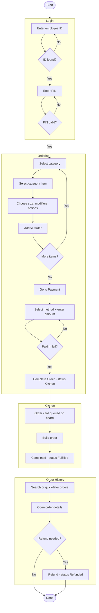

# Portfolio Demo - Point of Sale System
This app simulates a point of sale (POS) terminal running at the cash register of a fast food restaurant. The demo menu is modeled on a Mexican fast food restaurant.

**Cashiers** log in with an employee ID and PIN, take customer orders, and collect payment. Completed orders are sent to the **Kitchen** monitor so employees know which orders to build and any modifications to standard ingredients. Previous orders can be looked up in **Order History** and refunded if needed.

The app is optimized for a large tablet display in landscape, from 1280x1024 to 1920x1080.

## Running the demo
The demo is a client-only Vite + React + TypeScript app. All data is seeded in the
browser via a mock REST API (MSW), so no backend is required.

```bash
npm install     # install dependencies
npm run dev     # start the dev server (http://localhost:5173)
npm run build   # type-check and build for production
npm run test    # run the Vitest suite
npm run lint    # run ESLint
```

Log in with the demo employee shown at the bottom of the Login screen
(**Employee ID** `ABC123`, **PIN** `1111`). Use the footer navigation to move
between the Ordering, Order History, and Kitchen screens. There is no persistence;
reloading the page restores the seeded data and logs you out. The end-to-end
process is summarized in the [Workflow](#workflow) section below.

### Running with Docker
The `Dockerfile` builds the static bundle and serves it with nginx on port `6069`.
MSW runs in the browser as a service worker, so the mock API works in the deployed
static site with no server component.

```bash
docker build -t point-of-sale-demo .
docker run -p 6069:6069 point-of-sale-demo   # http://localhost:6069
```

## Design Documentation
Detailed design and architecture live in [design-docs/](design-docs/README.md).
All requirements originate from [features.md](design-docs/features.md).

| # | Document | Contents |
| --- | --- | --- |
| — | [features.md](design-docs/features.md) | Product requirements (source of truth). |
| 1 | [01-architecture.md](design-docs/01-architecture.md) | Stack, layers, key decisions, deployment. |
| 2 | [02-data-models.md](design-docs/02-data-models.md) | Domain TypeScript types & seed data. |
| 3 | [03-ui-components.md](design-docs/03-ui-components.md) | Screen layouts & component tree. |
| 4 | [04-api-contract.md](design-docs/04-api-contract.md) | Mock (MSW) endpoint contract. |
| 5 | [05-state-and-routing.md](design-docs/05-state-and-routing.md) | Zustand + TanStack Query + routing. |
| 6 | [06-project-structure.md](design-docs/06-project-structure.md) | Folder layout & conventions. |

# Technology
## Frontend Technology
The Frontend is built with React 19 and TypeScript using Vite. Material UI (MUI) v9 is the exclusive component library, including the MUI X Data Grid for Order History and MUI icons for menu buttons. All styling uses the MUI theme, `sx`, and `styled` (Emotion). The primary theme color is green (`#2eab4e`), defined in `src/theme.ts`.

State is split into two kinds. **Server state** (menu, orders, kitchen board) is owned by TanStack Query, which also provides the Kitchen screen's polling. **Client state** (the logged in session, the order being built, and payment entry) lives in Zustand stores. Routing uses React Router with an auth-guarded shell.

The code is organized feature-first, one folder per screen, with shared components, typed API wrappers, and stores alongside. All money is handled as integer cents and formatted only at render to avoid floating-point drift.

### Frontend Tech List
- Vite
- React
- TypeScript
- Material UI components (`@mui/material`, `@mui/x-data-grid`, `@mui/icons-material`)
- Emotion
- Tanstack Query
- React Router
- Zustand
- Vitest + React Testing Library

## Backend Technology
There is no real backend. Every API call goes through thin, typed `fetch` wrappers and is intercepted by Mock Service Worker (MSW) handlers, which serve the [API contract](design-docs/04-api-contract.md) from in-memory seed data. Because components and queries are written as if a real backend exists, the mock can be swapped for a live API without changing the UI.

Seed data is deterministic: a full menu, mock employees, and 15 historical orders are generated from a fixed dataset so the demo looks identical on every run. Payments are handled externally through an API call, which is also mocked.

### Backend Tech List
- Mock Service Worker (MSW)
- In-memory seed data (menu, employees, orders)
- Docker + nginx for static deployment

# Screens
The application has four screens. Ordering, Order History, and Kitchen share a footer with navigation between them.

## 1. Login
The Login screen has a number pad with the digits 0-9 and the letters A-D. The cashier enters a 6 character employee ID (0-9, A-D), which is not masked. An unknown ID shows the field in red with an error message. A valid ID reveals a masked 4 digit PIN field. A successful PIN takes the cashier to the Ordering screen. The demo credentials are shown at the bottom of the page.

## 2. Ordering
The Ordering screen has four vertical panes that drill down from left to right.

| Pane 1 | Pane 2 | Pane 3 | Pane 4 |
| --- | --- | --- | --- |
| **Categories** (Combos, Tacos, Drinks, ...) | **Category items** (Combo #2, Crunchy Taco, ...) | **Item selection and modification**: sizes, ingredient modifiers, and options such as the side or drink in a combo | **Order summary**: each item with its price and modifiers listed beneath |

**Add to Order** moves the selection from Pane 3 into the order summary. **Go to Payment** turns Pane 3 into a payment panel with payment method buttons (card, cash, gift certificate) and a number pad for the amount. Partial payments are allowed. Once payments add up to the total, **Complete Order** saves the order with a status of **Kitchen**.

## 3. Order History
Order History has a search bar (text and date range), a quick-filter pane, and a paginated results grid sorted newest to oldest. Quick filters cover time (Last 4 Hours, Today, Last 7 Days) and status (Kitchen, Fulfilled, Refunded). Selecting a row opens the order summary with its payments, plus a **Refund** button that marks the order as refunded.

## 4. Kitchen
The Kitchen screen shows up to eight order cards, filled left to right and top to bottom. Each card shows the order number in large bold type and the item details without prices. Long orders scroll automatically every 10 seconds. **Completed** marks the order as Fulfilled, removes the card, and shifts the remaining cards forward. Orders beyond the first eight wait until a slot opens.

# Access and Security
Security is intentionally minimal for the demo. Employees log in with an employee ID and a PIN.

The Ordering, Order History, and Kitchen screens are only available after a successful login. Unauthenticated users are redirected to the Login screen. Because the session lives in memory, reloading the page logs the user out.

Every order is tagged with the ID of the employee who created it.

PINs are stored in plain text in the seed data. This is for demonstration only and is not how a real system should store credentials.

# Workflow
## Overview
The diagram below shows the order lifecycle from login through payment, kitchen
fulfillment, and an optional refund.



## Order Statuses
| Status | Set by | Meaning |
| --- | --- | --- |
| Kitchen | Completing payment on the Ordering screen | Paid and waiting to be built. Shown on the Kitchen board. |
| Fulfilled | **Completed** on a Kitchen card | Built and handed to the customer. |
| Refunded | **Refund** in Order History | Payment returned to the customer. |

## Cashier
1. Log in with employee ID and PIN
2. Build the order
    - Select a category, then a category item
    - Choose size, modifiers, and options
    - Add to Order
3. Take payment
    - Select a payment method and enter the amount, including cents
    - Repeat for split payments until the total is paid
4. Complete the order
    - The order is saved with status Kitchen and appears on the Kitchen board

## Kitchen
1. View queued order cards (up to eight at a time)
2. Build each order using the listed items and modifications
3. Mark the order Completed
    - The order status becomes Fulfilled
    - The next waiting order moves onto the board

## Order History and Refunds
1. Search by text and date range, or use the time and status quick filters
2. Select an order to view its items and payments
3. Refund the order if needed
    - The order status becomes Refunded
